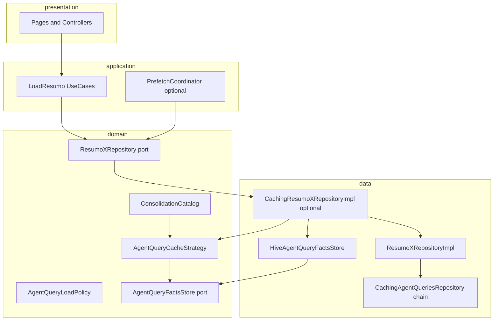

# Architecture — local storage and repository facts cache

## Problem

The overview home loads many agent SQL reports per filter change. Today:

1. **Transport cache** (`CachingAgentQueriesRepository`) reuses successful non-empty SQL results in client memory (default five seconds; catalog queries have a separate TTL).
2. **Facts store** (`HiveAgentQueryFactsStore`) persists closed day/month buckets per user, agent, and fact kind.
3. **`OverviewBatchLoader`** still batches non-migrated sections via SQL; daily and monthly sections load through cached repository ports when use cases are wired.

Business data for past calendar days/months is stable after ERP close. We persist reusable, filter-friendly facts without duplicating the same metrics under multiple cache shapes.

## Cache location and server feasibility

Reviewed on 2026-11-08 against the Colmeia implementation and the local
`plug_server` source/contracts. This is not a deployed-server inspection.

| Data | Current location | Granularity |
| --- | --- | --- |
| Short-lived SQL results | Colmeia process/browser memory | Request identity, agent, parameters and credential scope |
| Consolidated report facts | IndexedDB on Web; Hive on Android/Windows, through `AppCacheStore` | User, agent, fact kind, filter scope and closed period |
| Selected offline packages | Same local persistence abstraction | User/agent package containing multiple datasets and their metadata |
| PWA application files | Browser Cache Storage | Versioned static release; no authenticated report responses |

Repository decorators and strategies opt individual query types into persistent
fact caching. This is not a universal cache keyed only by a report name, nor a
copy of each rendered screen. Derived reports can reuse canonical facts; offline
packages preserve their own snapshots. Browser data is local to the origin and
browser profile, not shared across devices or uploaded to the hosting server.

No report-result cache was identified in the reviewed `plug_server` source.
Its authentication, catalog, presence and communication infrastructure caches
do not establish persistence of Colmeia report datasets. The bridge is external
to Colmeia's implementation scope.

A central report cache is technically feasible **as a separately scoped
Colmeia backend**, not as a change to `plug_server` or to static PWA hosting.
Before implementation, define that service's owner, hosting, authentication,
storage and data lifecycle. The proposed online flow would be:

```text
Colmeia app -> Colmeia report service -> plug_server -> agent/data source
                       |
                 server report cache
```

On an authorized cache hit, the report service can avoid a new source query.
On a miss, it obtains data through the existing bridge contract. A cache key
must include organization/authorization scope, source/store, report and schema
version, normalized filters and period; paging/sorting must also be included
when caching pages rather than complete bounded datasets. Do not use raw tokens
as persistent keys or trust caller-provided scope without server validation.

Define freshness per report, refresh/invalidation, bounded retention, concurrent
request coalescing and revocation before enabling cross-user reuse. Never cache
failures or incomplete responses as complete reports. Server caching does not
replace local offline packages or extend their permission expiry. This option
is a feasibility finding, not an implemented or approved new backend.

## Layering



### Dependency rules

| Layer | May depend on | Must not |
| ----- | ------------- | -------- |
| `domain` | Other domain types | Flutter, Hive, Dio, SQL strings |
| `application` | `domain` | Concrete `Caching*` types |
| `data` | `domain`, `core` | `presentation` |
| `overview` | `agent_queries` ports, own assembler | Own fact storage keys |

## Opt-in via DI (Option A)

Every report keeps a **network** implementation (`*RepositoryImpl`). Caching is enabled only when `injector_agent_queries.dart` registers a **decorator** as the port implementation:

```dart
// No business cache
repo: () => CadastroFilialRepositoryImpl(getIt()),

// With business cache
repo: () => CachingResumoTotalDiarioVendasRepositoryImpl(
  delegate: ResumoTotalDiarioVendasRepositoryImpl(getIt()),
  factsStore: getIt(),
  strategy: getIt(),
),
```

Use cases always depend on `ResumoXRepository`; they do not branch on decorator vs impl.

## In-flight invalidation

`BaseCachedAgentQueryRepository` advances an instance-local generation before
removing facts. Loads started under an older generation may return their results,
but cannot submit new persistent writes through unary, range-coalesced, or batch
paths. For simplicity, an invalidation fences all pending writes in that repository
instance, including other agents; subsequent loads can persist normally.
Cancelled loads return `OperationCancelledFailure` and do not submit new writes.
Already submitted writes remain ordered by the facts store mutation queue.

This is not cross-tab synchronization: other repository instances, direct facts
writers, and other browser tabs require separate lifecycle coordination.

## Components

### `AgentQueryCacheStrategy<Filter, Row>`

Per-report policy in `data/cache/strategies/`:

- Maps a range `Filter` to a list of **bucket ids** (day string, month key, …).
- Declares which buckets are **closed** relative to `clock`.
- Builds a **per-bucket** `Filter` for the delegate SQL call.
- Serializes/deserializes rows for the facts store.
- Exposes `factKind` and `AgentQueryKey` for the consolidation catalog.

### `AgentQueryFactsStore`

Single persistence port (`AppCacheStore`, with Hive on Android/Windows and
transactional IndexedDB on Web):

- `read` / `write` / `remove` by canonical storage key.
- Rejects `write` when catalog marks strategy as `derivedOnly`.
- Rejects duplicate writers for the same `FactKind` + bucket (replication control).

Canonical key shape (logical):

```text
{agentQueryFactsPrefix}{userId}:{agentId}:{factKind}:{cacheScopeId}:{bucketId}
```

Prefix constant: `AppKvCacheKeyPrefixes.agentQueryFacts`.

### `BaseCachedAgentQueryRepository`

Shared decorator logic:

1. If `cachePolicy` is `networkOnly` or strategy absent → delegate only.
2. `plan` buckets for filter + clock.
3. For `defaultLoad`: read closed buckets from store; collect misses + open buckets.
4. For `forceRefresh`: skip store reads for buckets in scope; always network for needed buckets.
5. Fill misses using range coalescing when supported, batch execution when
   available, or per-bucket loads. Preserve period aggregates that cannot be
   safely split; see the strategy contract.
6. `write` only **closed** buckets returned successfully.
7. Merge bucket rows into a single `List<Row>` for the port contract.

### `ConsolidationCatalog`

Static registry: `AgentQueryKey` → `FactKind`, storage mode (`persist` | `derivedOnly`), canonical writer keys. Used by store guardrails and documentation.

## Opportunistic cache layers

| Layer | Location | TTL | Scope |
| ----- | -------- | --- | ----- |
| Transport | `CachingAgentQueriesRepository` (client memory) | Default 5s; separate catalog TTL | Request identity and credential scope |
| Business facts | `AgentQueryFactsStore` | Until invalidate / schema bump | Closed buckets per fact kind |

`AgentQueryLoadPolicy.forceRefresh` bypasses the transport cache so
pull-to-refresh is not served from the short-lived SQL layer.

## Anti-replication

Do **not** persist:

- The same calendar day as both daily sales rows and a period-aggregated payment blob.
- Weekday distribution SQL results when daily facts can be aggregated client-side (catalog: `derivedOnly`).

Explicit PWA packages are a separate, user-selected snapshot area. Their derived and open-period datasets do not become canonical historical facts; see [Web/PWA lifecycle](../install/web_guide.md#offline-packages).

One **canonical writer** per `FactKind` + bucket. Readers (overview assembler, other reports) consume via repository ports or derived computation.

## Overview integration path

`OverviewBatchLoader` loads daily sales and monthly parcels per target via `LoadResumoTotalDiarioVendasUseCase` and `LoadResumoParcelasMensalUseCase` (decorated repositories). Section SQL batches exclude those queries when both use cases are injected. Other overview sections still use `executeSqlBatch` until migrated.

Missing `client_token` for a target fails with an explicit error in online
loads. The removed legacy overview snapshot fallback is not restored by PWA:
`OfflineOverviewRepository` reads an explicitly prepared, authorized package
only for its matching agent and period.

## Sign-out

`AppCacheStore.clearAll()` on session end must remove fact keys (same as other dashboard caches). Optionally `AgentQueryCacheControl.invalidateCache` with user scope before clear.

## Platform storage

- `AppCacheStore` uses transactional IndexedDB on Web through `idb_shim`.
  Android and Windows keep Hive. The Web adapter preserves the existing
  `app_kv_cache` database and `box` string store, so no bulk migration is needed.
  Reads consult committed browser data rather than a per-tab snapshot; writes,
  removals, and cache clearing become visible to subsequent reads in other tabs.
- Cache failures (blocked IndexedDB, quota, or unavailable storage) are logged and
  treated as misses by the generic adapter. Browser eviction can discard both
  opportunistic data and selected packages; storage persistence is not
  guaranteed. Package publication adds read-back verification and surfaces
  failures instead of reporting a successful download. The cache contains no
  authentication tokens. Clearing the cache
  clears its object store, without deleting
  a database that another tab may have open. Version changes close the connection
  so browser upgrades/deletions are not blocked by this adapter.
- The map branch catalog now uses `AppCacheStore`, with the same user/scope keys
  and four-minute TTL. Valid legacy preference snapshots are read on demand and
  moved to the cache; legacy preference entries for that user are removed.
- `shared_preferences` remains for small UI preferences. Its in-memory view is
  not a live cross-tab synchronization mechanism. Feature/controller caches also
  keep their existing TTL/refresh policy; database coherence does not broadcast
  UI refreshes or authentication events to other tabs.
- Authentication continues to use `flutter_secure_storage` with WebCrypto and
  browser local storage. Clearing site data removes sessions and caches.
  Encryption does not prevent same-origin scripts/XSS from accessing tokens;
  this is not a hardware-backed keystore or an HttpOnly cookie. A cookie-based
  session design would require coordinated backend and Socket authentication
  changes and is outside this storage adaptation.
- Secure-storage read/write/delete failures surface as `StorageFailure`, including
  browser quota/security failures. Failed writes are not reported as persisted.
  A failed deletion masks the old value in the current `SessionStorage` instance
  and reports the failure; it cannot guarantee removal from persistent storage.
  Missing-plugin fallback remains process-local for non-integrated environments.

`HiveAgentQueryFactsStore` retains its existing class name but depends on
`AppCacheStore`, so the same facts envelope works with either platform adapter.
The factory in [injector_core.dart](../../lib/core/di/injector_core.dart) selects
the adapter through conditional imports and disposes it with the DI container.

## Selected offline packages

PWA snapshots use `pwa/package/<user>/<agent>` and a separate selected-agent index.
The package writer verifies the committed value because ordinary cache writes may
log failures and continue. Quota failures therefore cannot be reported as successful
offline downloads. Packages are published as complete generations and checked against
a server-issued 24-hour permission grant on every read. They are not a replacement
for fact-bucket consolidation or a new queue of business mutations.

Web Locks prevent simultaneous downloads of the same user's agent package across tabs.
Selection-list changes use a separate, short user lock; removing or cancelling an
agent does not cancel another agent's download.
BroadcastChannel invalidates local sessions on logout. These lifecycle controls belong
to the PWA layer; generic cache coherence alone does not provide authorization.

## Local scheduled refresh

`agent_queries/domain/scheduling` defines schedules, execution state, typed filter
descriptors and ports. `CacheRefreshCoordinator` runs after authentication on Web,
Android and Windows. Settings > **Atualização de dados** provides explicit creation,
editing, pausing, removal and manual execution. No server cache or server scheduler
is introduced; `plug_server` remains the communication channel to distributed agents.

Schedules use `refresh/v1/<user>/job/<id>` and a user index in `AppCacheStore`.
The identity includes user, agent, report/version, normalized filters and period.
Intervals are 15 minutes, one hour, two hours (default) and 24 hours. Existing
explicitly persisted intervals are preserved. New schedules are due
immediately. Last-30-day ranges are recomputed on execution; fixed calendar dates
are preserved and validated. Paginated reports prepare the configured page only;
margin and purchase-item queries retain their existing point-in-time semantics.

The catalog in `injector_cache_refresh_reports.dart` covers nine overview sections,
ten sales/purchase queries and a composite selected offline package. Adapters call
existing repositories with forced refresh. Query capture forces bypass of transport
caches, propagates cancellation and stores normalized result snapshots separately
from historical facts. Fingerprints are hashed; SQL and tokens are not persisted in
schedules or snapshots. Row-count inconsistencies and results hitting configured
row caps prevent complete publication. Native repository consolidation rules remain
unchanged. Compatible ordinary online requests may reuse snapshots after permission
revalidation; explicit refresh bypasses them. Offline reads still require existing
packages and their server-issued permission lease.

Record format 2 separates small metadata from immutable snapshots under
`refresh/v1/<user>/snapshots/<job>/<generation>`. The existing namespace is retained
for migration. The snapshot is written and verified first; a single verified metadata
write publishes its pointer, size, query fingerprints and state atomically. Failed or
discarded writes leave the previous pointer valid and cannot report success. Listing,
eligibility and diagnostics read only metadata; ordinary cache lookups load a result
only after its fingerprint matches. Obsolete generations are cleaned after publication.

Format 1 records migrate lazily under the user index lock, retaining the old record
until publication succeeds. Invalid JSON, identity mismatches and unsupported record
formats are quarantined individually, displayed as suspended and preserved until
explicit removal. They cannot block valid jobs. Unknown formats are never guessed or
silently overwritten. Default filters are normalized at schedule construction, including
direct repository callers and restored records; empty optional values and explicit
report defaults do not create distinct schedules. Fixed dates remain significant;
unused fixed endpoints do not affect rolling-period identity.

Revisions prevent edited, removed or superseded jobs from
publishing late results. Pausing retains the last completed snapshot. Logout stops
work and removes the user's schedules; confirmed agent revocation removes snapshots
for all its schedules and invokes the package cleanup path.

At most two agents execute concurrently per user across same-origin browser tabs,
one job per agent, inside the existing transport gates. Two nonblocking Web Lock
slots enforce aggregate capacity; occupied slots defer work without holding a queue
ahead of unrelated agents. Native instances share the injected lock within their
process. This is not a server-wide or cross-device limit.
Agent locks include the user; a second browser tab rereads the
revision after acquiring the Web Lock and skips work already completed. Offline
agents are deferred independently. Hub/network outages delay remote work; isolated
query timeouts do not mark an agent offline. Backoff starts at 30 seconds and grows
to 15 minutes, with ±20% jitter and `Retry-After` support. Presence events are ordered
by observation time and trigger permission/presence reconciliation. Resume performs
one overdue refresh rather than replaying every missed interval.

`CacheRefreshLifecycle` starts/stops the coordinator with the session, forwards
foreground/connectivity/presence events and enrolls selected PWA packages as composite
jobs. Push reconciliation is independent of cache execution. `PwaStatusHost` retains
presentation and offline-expiry enforcement, not periodic package downloads. Active
jobs participate in the PWA update busy guard. Execution with the application closed
is not guaranteed and no OS background service has been added.

UI states are **Aguardando atualização**, **Atualizando**, **Aguardando agente**,
**Aguardando conexão**, **Tentativa adiada**, **Pausado** and **Acesso indisponível**.
Each entry shows its agent, period, interval, last successful collection, next
attempt, last execution duration, snapshot size and actionable deferral reason.
Storage failures that also prevent diagnostic persistence remain visible in the
current coordinator's transient state, without reporting success or replacing data.
Quarantined records offer explicit removal; their edit/resume actions are disabled.
Removing a schedule does not delete a selected offline package. Operational
`cache.refresh.*` events record report, failure category, publication outcome and
duration without query text, credentials or financial rows.
